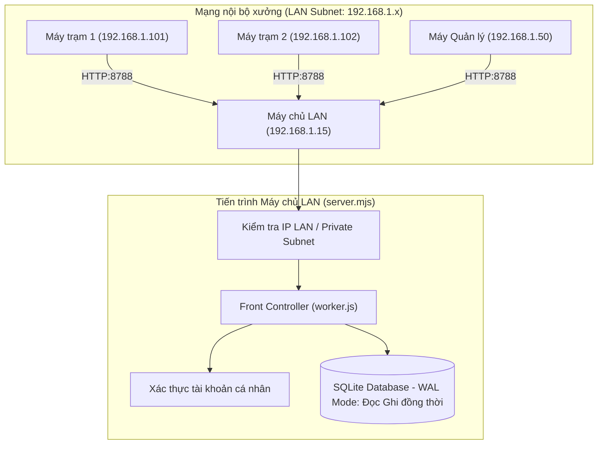

# Kế hoạch Tối ưu hoá Hệ thống chạy Mạng LAN Nội bộ (Offline 100%)

## [Goal Description]
Chuyển đổi và tối ưu hoá hệ thống TechOps từ chế độ phát triển/Cloudflare sang **Máy chủ mạng LAN nội bộ độc lập (100% Offline)** để phục vụ cán bộ, kỹ sư và công nhân trong phân xưởng/nhà máy mà không phụ thuộc vào Internet hay dịch vụ đám mây bên ngoài.

Các mục tiêu kỹ thuật cụ thể:
1. **Quy trình Đăng ký & Phê duyệt Offline (No Email Verify, Admin Approval Required)**:
   - Trong mạng LAN không có internet/máy chủ mail, người dùng đăng ký tài khoản thành công ngay lập tức mà không cần bấm link xác nhận qua email.
   - Tuy nhiên, tài khoản mới tạo sẽ ở trạng thái **Chờ phê duyệt (`Pending`)** (`email_verified_at = NULL`). Người dùng **chưa thể đăng nhập ngay**.
   - Quản trị viên vào trang **Quản trị người dùng (`/admin/users`)** xem danh sách và bấm nút **"Phê duyệt" (Approve)** thì tài khoản mới được kích hoạt và bắt đầu sử dụng.
2. **Lắng nghe toàn mạng LAN (`0.0.0.0`)**: Cho phép các máy tính khác trong cùng mạng nội bộ (WiFi / dây mạng Ethernet) truy cập qua địa chỉ IP của máy chủ (ví dụ: `http://192.168.1.15:8788`).
3. **Mở khóa truy cập IP nội bộ (LAN IP Whitelist)**: Nhận diện tự động các dải IP Private (`192.168.x.x`, `10.x.x.x`, `172.16-31.x.x`, `127.0.0.1`) để các tài khoản thành viên (`member`) không bị chặn bởi bộ lọc IP văn phòng WAN cũ.
4. **Chế độ máy chủ thật (Multi-user Production Server)**: Tách biệt với `preview.mjs` (vốn tự động đăng nhập admin giả lập), server LAN mới sẽ yêu cầu đăng nhập tài khoản thực tế cho từng người dùng, lưu ngôn ngữ và phiên làm việc riêng của từng người.
5. **Tối ưu tốc độ & Concurrency cho SQLite (WAL Mode)**: Kích hoạt chế độ `PRAGMA journal_mode = WAL;` (Write-Ahead Logging) và `busy_timeout = 5000` trên file database `techops_local.db` để hàng chục/hàng trăm máy trạm đọc ghi cùng lúc mà không bị nghẽn hay khóa database (`database is locked`).
6. **Tiện ích vận hành 1-click & Sao lưu (Backup)**: Tạo file `start-lan.bat` để click đúp là chạy, tự động hiển thị link truy cập LAN trên màn hình; bổ sung lệnh sao lưu database an toàn `npm run db:backup`.

---

## User Review Required

> [!IMPORTANT]
> **1. Quyền truy cập đăng nhập trong LAN:**
> Ở phiên bản Cloudflare cũ, thành viên (`member`) chỉ được đăng nhập khi truy cập từ 3 IP tĩnh WAN (`117.4.33.107`, `14.241.73.189`, `134.231.132.48`). 
> Trong kế hoạch này, khi chạy ở chế độ LAN, hệ thống sẽ **tự động cho phép tất cả các IP thuộc dải mạng nội bộ** (`192.168.*.*`, `10.*.*.*`, `172.16-31.*.*`, `127.0.0.1`). Admin vẫn có thể quản lý, phê duyệt tài khoản mới hoặc khoá tài khoản bất cứ lúc nào qua trang `/admin/users`.

> [!NOTE]
> **2. Dịch thuật tiếng Hàn/Việt khi không có Internet:**
> Khi không có kết nối ra ngoài để gọi Cloudflare AI, hệ thống sẽ dùng **Từ điển tĩnh sẵn có** (`src/i18n/`) và **Bộ nhớ đệm dịch trong Database** (`tech_translation_cache`). Mọi giao diện, nút bấm, menu, bảng biểu đều hiển thị đúng ngôn ngữ bạn chọn.

---

## Open Questions

Không có vấn đề chặn. Các cấu hình được thiết kế theo dạng cắm-rút (plug & play), không ảnh hưởng đến bộ test suite hiện có.

---

## Proposed Changes



---

### Tầng Máy chủ & Mạng (Server & Networking)

#### [NEW] `techops/server.mjs`
- Khởi tạo máy chủ HTTP chuyên dụng cho môi trường mạng LAN Production.
- Tự động quét card mạng bằng `node:os` để tìm IP nội bộ của máy chủ (ví dụ `192.168.1.15`) và in đường dẫn rõ ràng lên console để người dùng chỉ việc chia sẻ link cho đồng nghiệp.
- Lắng nghe trên `0.0.0.0:8788` (hoặc cổng cấu hình qua `PORT`).
- Trích xuất chính xác IP của máy trạm từ `req.socket.remoteAddress`, loại bỏ tiền tố `::ffff:`.
- Không ép phiên `preview-session` như `preview.mjs`, cho phép người dùng đăng nhập bằng tài khoản cá nhân của họ.
- Kích hoạt chế độ SQLite WAL:
  ```javascript
  db.exec("PRAGMA journal_mode = WAL;");
  db.exec("PRAGMA synchronous = NORMAL;");
  db.exec("PRAGMA busy_timeout = 5000;");
  ```

#### [MODIFY] `techops/src/routes/auth.js`
- Nâng cấp cơ chế kiểm tra IP: Bổ sung kiểm tra dải IP Private LAN (`isPrivateLanIp`).
- **Cơ chế Phê duyệt Quản trị viên (Admin Approval Required)**:
  - Bổ sung biến kiểm tra `env.REQUIRE_ADMIN_APPROVAL` (khi bật cờ này hoặc ở chế độ LAN):
    - Tài khoản đăng ký mới sẽ lưu với `email_verified_at = NULL` (không cần gửi email).
    - Màn hình sau khi đăng ký sẽ chuyển hướng đến `/login?pending_approval=1` hiển thị thông báo rõ ràng: *"Đăng ký thành công! Tài khoản đang chờ Quản trị viên phê duyệt trước khi có thể đăng nhập."*
    - Khi đăng nhập trước khi được duyệt, hệ thống từ chối với thông báo: *"Tài khoản của bạn chưa được phê duyệt. Vui lòng liên hệ Quản trị viên."*
    - Admin vào `/admin/users` nhấn nút **"Phê duyệt"** là tài khoản lập tức đăng nhập được.
- Giữ nguyên cơ chế kiểm tra IP WAN cũ trong môi trường test để đảm bảo bộ test `tests/test.mjs` vẫn **100% PASS**.
- Nếu request đến từ IP mạng nội bộ (`192.168.x.x`, `10.x.x.x`, `172.16-31.x.x`, `127.0.0.1`) HOẶC biến môi trường `env.ALLOW_LAN_IPS = true` được bật, thành viên được phép đăng nhập bình thường.
- Giữ nguyên cơ chế kiểm tra IP WAN cũ trong môi trường test để đảm bảo bộ test `tests/test.mjs` vẫn **100% PASS**.

#### [MODIFY] `techops/package.json`
- Bổ sung lệnh chạy:
  - `"start:lan": "node server.mjs"` (khởi động máy chủ mạng LAN)
  - `"db:backup": "node scripts/backup-db.mjs"` (sao lưu database tức thời)

---

### Tiện ích Vận hành & Sao lưu (Scripts & Utilities)

#### [NEW] `techops/start-lan.bat`
- File Batch Script dành riêng cho Windows Server / Máy trạm văn phòng.
- Người dùng chỉ cần click đúp vào file này, console sẽ bật lên, tự động chạy máy chủ và hiển thị link mạng LAN để mọi người cùng truy cập mà không cần gõ lệnh phức tạp.

#### [NEW] `techops/scripts/backup-db.mjs`
- Script thực hiện lệnh SQLite native `VACUUM INTO` để tạo file backup an toàn ngay cả khi database đang có người đọc/ghi.
- Lưu trữ vào thư mục `techops/backups/techops_backup_YYYY-MM-DD_HH-mm-ss.db`.

---

## Verification Plan

### Automated Tests
1. **Kiểm tra tương thích toàn bộ hệ thống cũ:**
   ```powershell
   cd "f:\workspace code\DuAnCuaOngLee\techops"
   pnpm test
   ```
   *Yêu cầu*: 371/371 bài test PASS, không có bất kỳ bài test nào bị gãy hay sai lệch logic.

2. **Kiểm tra phân hệ Q-EVAL & LOT-Tracker:**
   ```powershell
   node evaluation/test.mjs
   node lot-tracker/trace/test/test-regression.cjs
   ```
   *Yêu cầu*: 43/43 Evaluation tests PASS, 28/28 Trace regression tests PASS.

### Manual Verification
1. **Khởi động Server LAN:**
   - Chạy `npm run start:lan` (hoặc click `start-lan.bat`).
   - Kiểm tra console có in ra đúng IP mạng LAN (ví dụ `http://192.168.x.x:8788`).
2. **Kiểm tra đa người dùng (Multi-User Login):**
   - Mở trình duyệt ẩn danh (Incognito) hoặc mở từ máy tính khác trong cùng mạng LAN truy cập vào `http://<IP-LAN>:8788`.
   - Trang web chuyển hướng về `/login`.
   - Đăng nhập bằng tài khoản `admin@hanyangdgtvina.com` hoặc tài khoản `member`, kiểm tra hiển thị thông tin profile và nhớ ngôn ngữ theo tài khoản.
3. **Kiểm tra sao lưu DB:**
   - Chạy `npm run db:backup`, kiểm tra thư mục `backups/` có sinh file `.db` hoàn chỉnh.
